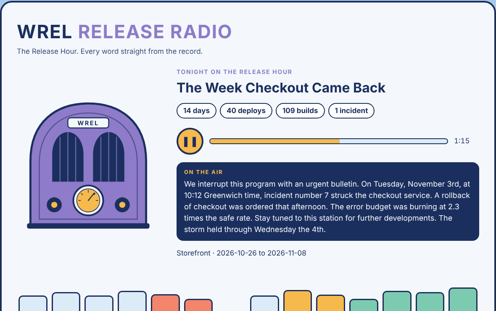

# Release Radio

**Good evening, ladies and gentlemen. Your release is on the air.**

WREL's Release Hour: two weeks of deploys, CI runs, incidents and SLO burn, read on the air by a 1940s radio announcer. A jazz-age theme plays him in, a chime sounds before every urgent bulletin and every word he says comes straight from the record.

[](https://github.com/j-m-o/release-radio/actions/workflows/ci.yml)

<p align="center">
  
</p>

## Why this exists

A delivery dashboard tells you there was an incident on the 3rd. Release Radio has a man in a good suit interrupt the program to tell you, at 10:12 Greenwich time, that incident number 7 struck the checkout service. People skim charts. They listen to a bulletin.

The broadcast sits on top of the evidence, never instead of it. The script is written by fixed rules, the same data always makes the same broadcast and The Record shows the deploy, run or incident behind every line. The announcer is charming. He is not allowed to improvise.

## Run the demo

Python 3.9+, standard library only, no network.

```bash
python skills/release-radio/scripts/radio.py demo --out radio
```

Open `radio/player.html` and press play. Without a recorded voice, the theme plays and your browser's own voice reads the script. A pre-rendered copy is in [`docs/demo/`](docs/demo/): the [broadcast](docs/demo/broadcast.mp3), the [script](docs/demo/script.md) and [The Record](docs/demo/the_record.md).

The demo is "The Week Checkout Came Back", a fictional storefront:

> We interrupt this program with an urgent bulletin. On Tuesday, November 3rd, at 10:12 Greenwich time, incident number 7 struck the checkout service. A rollback of checkout was ordered that afternoon. The error budget was burning at 2.3 times the safe rate. Stay tuned to this station for further developments.

## How a day is reported

| The day | On the air |
| --- | --- |
| Clean builds, deploys going out | Fair skies with the deploy and build counts |
| Failed builds on the main line | Rough going, failed out of total and the flaky test by name |
| No deploys and no builds | A deploy freeze. All quiet on the main line |
| An incident opens | A chime, then an urgent bulletin: when, what, which service, any rollback and the SLO burn |
| The incident resolves | The all clear, how many hours it took and how the days after went |
| A data source is missing | The sign off says the signal carried static. Nothing is guessed |

Runs of the same kind of day become one segment. The full rules are in [`references/rules.md`](skills/release-radio/references/rules.md).

## A real announcer

The demo broadcast uses Clyde, the vintage male radio announcer in the ElevenLabs voice library. Two ways to get a real voice:

**One recorded read.** Generate `radio/script.txt` as a single read in any voice tool (it is one paragraph per segment), convert it to WAV and pass it in. The mixer splits it at the pauses between paragraphs and checks every piece against its word count, so a bad split fails loudly instead of putting the wrong words under a caption.

```bash
python skills/release-radio/scripts/radio.py demo --out radio --voice-file clyde_read.wav
```

**The ElevenLabs API.** One call per segment, cached by voice, model and text, so a re-run costs no credits. Only the script text leaves your machine.

```bash
export ELEVENLABS_API_KEY=your-key
python skills/release-radio/scripts/radio.py demo --out radio --voice elevenlabs --voice-id QMJTqaMXmGnG8TCm8WQG
```

Either way you get `radio/broadcast.wav` and a player with live captions: the theme opens and fades under the sign on, the announcer is put through an old valve radio, a chime sounds before the bulletin and the theme comes back under the sign off.

## Reading it live

`script.md` is a cue sheet with theme and chime cues. The player has a theme button and a chime button, so a speaker can be the announcer in the room.

## Use your own data

Gather five small JSON files (deployments, CI runs, incidents, SLO burn and a manifest) from GitHub, your incident tool and your observability tool. The shapes are in [`references/data-contract.md`](skills/release-radio/references/data-contract.md).

```bash
python skills/release-radio/scripts/check_data.py my-data
python skills/release-radio/scripts/radio.py play --data my-data --out radio
```

## As an agent skill

`skills/release-radio/` is a standard `SKILL.md` skill. Build the upload zip with `python scripts/build.py`. An agent with GitHub, incident and observability connectors gathers the raw records, the engine writes the script and a person decides whether it goes on the air. The agent definition is in [`agents/release-radio.md`](agents/release-radio.md).

Agents gather, rules decide, a human approves. The agent never writes a line.

## What's in the box

| Path | What it is |
| --- | --- |
| `skills/release-radio/scripts/radio.py` | The engine: data in, days sorted, outputs written |
| `skills/release-radio/scripts/broadcast.py` | The announcer's script, the one-read text and the live cue sheet |
| `skills/release-radio/scripts/mix.py` | The broadcast mixer: theme, valve-radio voice, chime, crackle and the one-read splitter |
| `skills/release-radio/scripts/voice.py` | The optional ElevenLabs API step, with caching |
| `skills/release-radio/scripts/player.py` | The offline player page and The Record |
| `skills/release-radio/scripts/check_data.py` | The data contract checker |
| `skills/release-radio/assets/theme/` | The WREL theme |
| `tests/` | 33 tests: the rules, the script, the splitter, the mix, the API path (with a stand-in), missing data, the offline player |

## Roadmap

- **v1.1** A PR bulletin: a short broadcast for one pull request, posted as an advisory PR comment with the player as a build artifact. A weekly Slack post with the broadcast.
- **v1.2** Longer windows (a quarter as a season of shows) and more segment kinds: a release going out, a security advisory, a record streak.
- **v2** Tea Leaves Radio: the Quality Tea Leaves reading delivered on the air. The Bestiary Hour: a field report on the Bug Bestiary's species.

## Related

- [Quality Tea Leaves](https://github.com/j-m-o/quality-tea-leaves): a tarot reading of your quality metrics.
- [Bug Bestiary](https://github.com/j-m-o/bug-bestiary): your bugs as a conservation field guide.

## License

Copyright (c) 2026 Jessica Mosley. All rights reserved. See [NOTICE.md](NOTICE.md).

Created by Jessica Mosley | [LinkedIn](https://www.linkedin.com/in/jessmosley/) | [GitHub](https://github.com/j-m-o/)
